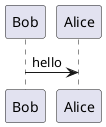

# PUML Viewer for Obsidian

A plugin for Obsidian that renders PlantUML/Mermaid from diagram files and from markdown code blocks.

## Features

- Custom diagram file view (`.puml`, `.mermaid`, `.mmd`, `.marmaid`) with two modes:
  - `View` (diagram)
  - `Edit` (source code with line numbers)
- Diagram toolbar actions:
  - refresh
  - zoom in / reset / zoom out
  - export buttons (SVG icons) to save as:
    - `.png`
    - `.svg`
    - `.txt` (ASCII Art)
- Drag-to-pan in diagram view when content is scrollable
- Auto-fit diagram to viewer width on render
- Auto-refresh on source file change
- Startup recovery: reopen and render previously opened diagram file after Obsidian restart
- Markdown embedded rendering for fenced blocks:
  - ` ```plantuml `
  - ` ```mermaid `
  - switch between `View Code` and diagram
  - `Zoom` overlay with drag-to-pan and zoom controls
  - save diagram with format chooser (`Save as PNG` / `Save as SVG`)
  - optional width hint in fence: ` ```plantuml |500 `
  - width hint limits only diagram area; code view uses full available block width
- PlantUML code coloring in embedded `View Code` mode
- Works with:
  - PlantUML server
  - Kroki (`https://kroki.io`)
  - Local server (for example `http://localhost:8000`)
  - PlantUML JAR (desktop)
- Supports both `SVG` and `PNG`

## Build

```bash
npm install
npm run build
```

## Install into Obsidian

Copy these files into:

```text
<YourVault>/.obsidian/plugins/puml-viewer/
```

Files:
- `main.js`
- `manifest.json`
- `styles.css`
- `versions.json`

Then enable the plugin in **Settings → Community plugins**.

## Usage

### Open diagram files

- Open a supported diagram file (`.puml`, `.mermaid`, `.mmd`, `.marmaid`) and run command:
  - `Open current diagram file in viewer`
- Switch between `View` and `Edit` modes in the toolbar.

The dedicated viewer gives you a diagram-first workspace for standalone files, with quick switching back to the editable source when you need to adjust the markup.


Source editing stays in the same view, so you can iterate on PlantUML without leaving the file context.


### Markdown blocks

Basic block:

~~~md

~~~

Mermaid block:

~~~md

~~~

Block with width hint:

~~~md

~~~

- `|500` means max diagram block width in pixels.
- In rendered block, use:
  - `View Code` to toggle source/diagram
  - `Zoom` to open fullscreen overlay
  - save icon to choose `PNG` or `SVG`

Rendered markdown blocks stay inside the note preview, which makes them usable for documentation, specs, and presentation notes without opening a separate file.


For larger diagrams, the fullscreen zoom overlay adds navigation controls and drag-to-pan, so dense schemes remain readable.


Export actions are available directly from the rendered block when you need to reuse the diagram outside Obsidian.


## Settings

- `Render mode`: `PlantUML` / `Kroki` / `Local` / `JAR`
- Separate URLs:
  - `PlantUML URL` (example: `https://www.plantuml.com/plantuml`)
  - `Kroki URL` (example: `https://kroki.io`)
  - `Local URL` (example: `http://localhost:8000`)
- `Kroki diagram type`: `PlantUML` / `Mermaid`
  - Used as default for Kroki requests when diagram type is not explicitly implied by code block language.
- `Image format`: default render format for viewer (`SVG` or `PNG`)
- `Embedded block default view`: show diagram or code first
- `Embedded diagram alignment`: `left` / `center` / `right` (default `center`)
  - Applied immediately in markdown preview without Obsidian restart

### Render with a PlantUML JAR

On Windows, Linux, and macOS, install a Java runtime compatible with your
[PlantUML JAR](https://plantuml.com/download). Some diagram types also need
[Graphviz](https://plantuml.com/graphviz-dot).

1. Choose `JAR` in **Render mode**. The **PlantUML JAR** group appears below **Local URL**.
   The `Local` option uses a local HTTP server.
2. Keep **Java executable** set to `java` if Obsidian can find it. Otherwise,
   select the executable with **Browse…** or enter its full path.
3. Select `plantuml.jar` with **Browse…** or enter its full path in **JAR path**.
4. **Image size limit** sets the maximum width or height in pixels. Clear it
   to restore the default of `4096`.

Use one diagram per block or file. SVG and PNG use the first page of diagrams
with `newpage`. ASCII export can include all pages for supported diagram types.
Older JAR versions can return a PNG with an error message after a Graphviz
crash. If this happens, check your Graphviz installation or update your JAR.

Relative `!include` paths start from the folder of the Markdown note or
`.puml` file. A request without a source file starts from the vault root.

Mermaid uses Kroki in HTTP modes. On Android and iOS, choose an HTTP mode.
If JAR mode is synced from desktop, the plugin prompts you to choose an HTTP mode.

## Disclosures

- **Network usage** — HTTP modes send diagram source to the configured
  server. In JAR mode, the source goes to the Java process. Directives such
  as `!includeurl` can make network requests under PlantUML's security profile.
- **Accounts / payments**: not required.
- **Telemetry / ads**: none.
- **External process and file access** — JAR mode runs the selected Java
  executable with the specified JAR. PlantUML can read files allowed by its
  security profile and your account permissions.
